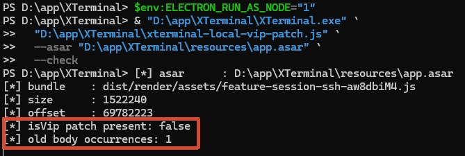
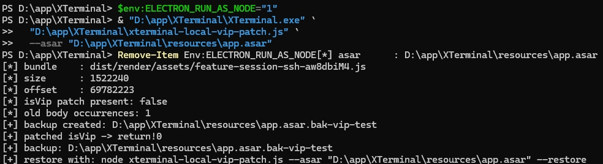
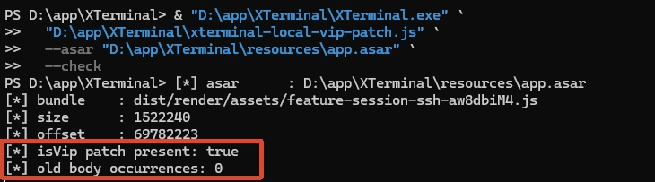

# Xterminal功能审计

该研究仅用于本地离线环境的应用审计研究，用于探究软件安全性，绝无云端服务破坏行为。

---
声明：本研究初衷是对未开源terminal工具在工作环境中危险程度的研究，并未对风险点中危害度高具体内容进行公开。

> 应用版本: 5.8.6

配置安全: 不存在**异常**上传服务器配置的功能代码。

风险点（由高到低）：

- 回环地址RPC服务未认证，导致任意socket连接可未鉴权调用RPC完成RCE
- 全局关闭 TLS 校验 + 未签名更新，可能导致更新通道被中间人利用
- 云端上传服务器配置时，ip port username 为明文
- 设置的本地密码用明文存储在sql中
- 存在本地VIP绕过方式

## 使用意见

1. 回环地址RPC服务随程序启动而启动，没有配置项可关闭。建议程序仅安装在非管理员用户下
2. 如有更新，请手动下载最新版本。不通过内置升级方式升级

## 说明

### RPC服务未认证导致RCE

仅在回环地址监听服务，不会在设备网络中开放。理论存在危害风险但通常不会导致RCE，降低用户权限可减小破坏范围。

## 本地VIP绕过

该处内容仅用于证明审计整体的可信度，不用于公开传播破解方案。

1. **step 1: 下载脚本**

复制内容或从github拉取本项目，脚本名称为xterminal-local-vip-patch.js

2. **step 2: 放置到安装目录下**

需要自己确认xterminal的安装绝对路径如："D:\app\xterminal"，放置到文件夹下即可，如："D:\app\xterminal\xterminal-local-vip-patch.js"

3. **step 3: 检查当前权限状态**

用 powershell 运行以下命令进行权限检查，其中"D:/app/xterminal"为你的安装路径
```cmd
$env:ELECTRON_RUN_AS_NODE="1"
& "D:\app\XTerminal\XTerminal.exe" `
  "D:\app\XTerminal\xterminal-local-vip-patch.js" `
  --asar "D:\app\XTerminal\resources\app.asar" `
  --check
```
预期结果如下，出现红框中内容为**未授权**


4. **step 4: 运行**

用 powershell 运行以下命令进行权限调整，其中"D:/app/xterminal"为你的安装路径
```cmd
$env:ELECTRON_RUN_AS_NODE="1"
& "D:\app\XTerminal\XTerminal.exe" `
  "D:\app\XTerminal\xterminal-local-vip-patch.js" `
  --asar "D:\app\XTerminal\resources\app.asar"
Remove-Item Env:ELECTRON_RUN_AS_NODE
```
预期结果如下图


5. **step 5: 复查权限状态**

用 powershell 运行以下命令进行权限检查，其中"D:/app/xterminal"为你的安装路径
```cmd
$env:ELECTRON_RUN_AS_NODE="1"
& "D:\app\XTerminal\XTerminal.exe" `
  "D:\app\XTerminal\xterminal-local-vip-patch.js" `
  --asar "D:\app\XTerminal\resources\app.asar" `
  --check
```
预期结果如下，出现红框中内容为**已授权**


